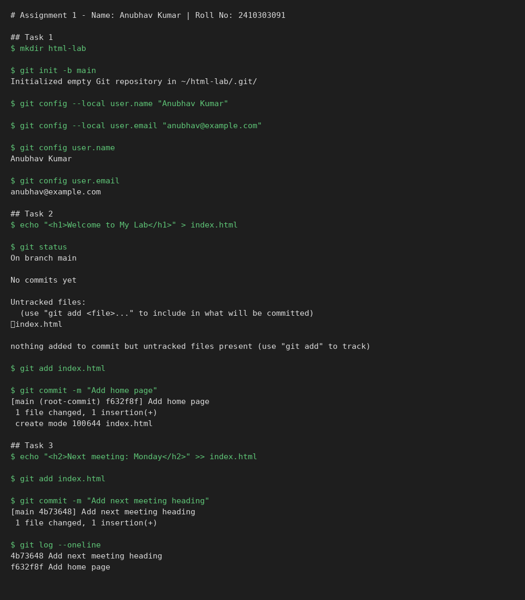

# Lab 1: Git: Setting Up a Repository and Making Commits

**Name:** Shekhar
**Roll No:** 2410303457 
**Course:** BCS554 - HTML & CSS Development Lab

## Aim
Create a repository, set the user details and make commits.

## Files
- `index.html` - the file that was committed in the repository (final version)

## Commands and output
```
# Assignment 1 - Name: Anubhav Kumar | Roll No: 2410303091

## Task 1
$ mkdir html-lab

$ git init -b main
Initialized empty Git repository in ~/html-lab/.git/

$ git config --local user.name "Anubhav Kumar"

$ git config --local user.email "anubhav@example.com"

$ git config user.name
Anubhav Kumar

$ git config user.email
anubhav@example.com

## Task 2
$ echo "<h1>Welcome to My Lab</h1>" > index.html

$ git status
On branch main

No commits yet

Untracked files:
  (use "git add <file>..." to include in what will be committed)
	index.html

nothing added to commit but untracked files present (use "git add" to track)

$ git add index.html

$ git commit -m "Add home page"
[main (root-commit) f632f8f] Add home page
 1 file changed, 1 insertion(+)
 create mode 100644 index.html

## Task 3
$ echo "<h2>Next meeting: Monday</h2>" >> index.html

$ git add index.html

$ git commit -m "Add next meeting heading"
[main 4b73648] Add next meeting heading
 1 file changed, 1 insertion(+)

$ git log --oneline
4b73648 Add next meeting heading
f632f8f Add home page
```

## Screenshot


> The image is drawn from the captured command output. Replace it with a screenshot of your own terminal.
